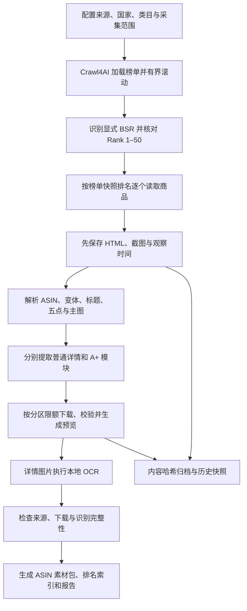

> 2026-11-03 注释更新：代码文件头、函数参数/输出及关键分支已补中文说明，配置见 [配置核对入口](../config/README.md)。当前还有 sources.py（多来源）、catalog.py（分类身份）、material_links.py（素材关联）与download_video.py（独立续传视频）；新导出路径为国家/网站/品类/商品/批次，以下早期目录保留作历史说明。

> 2026-11-03 注释更新：已恢复文件、函数、参数及关键分支的详细说明，配置见 [配置核对入口](../config/README.md)。当前还有 sources.py（多来源）、catalog.py（分类身份）、material_links.py（素材关联）与download_video.py（独立续传视频）；新导出路径为国家/网站/品类/商品/批次，以下早期目录保留作历史说明。

# 第一阶段：采集并建立可追溯素材库

本项目对应原七步流程的第①步。目前实现了 Amazon 美国站 Mattress Toppers 的采集、图文解析、媒体归档、详情补采及按 ASIN 交付，是可运行的命令行采集核心。

## 当前目录

```text
D:\Crawl4AI\
├─ run_topper.ps1                启动采集、检查运行环境
├─ pyproject.toml                Python 依赖与测试配置
├─ uv.lock                       独立环境依赖锁文件
├─ README.md                     使用入口
├─ config/
│  └─ topper-us.json             来源、范围、请求间隔、图片限额
├─ listing_ingest/
│  ├─ __init__.py
│  ├─ __main__.py               命令行参数入口
│  ├─ runner.py                 串起抓取流程、快照与运行报告
│  ├─ amazon.py                 Amazon 榜单、商品及变体解析
│  ├─ content.py                普通详情/A+ 分区、模块顺序、完整性检查
│  ├─ media_collect.py          独立分区限额、媒体下载调度和重试
│  ├─ storage.py                下载验证、SHA-256 去重、原件与预览归档
│  ├─ ocr.py                    本地 OCR 调用、源图关联和缓存
│  ├─ ocr_image.ps1             Windows 原生识别后端
│  ├─ export_products.py        按国家/ASIN/批次导出、生成排名索引
│  ├─ detail_export.py          生成模块化详情预览、原文和识别文本
│  ├─ enrich_details.py         利用已有快照补采详情与 A+ 图片
│  └─ review_snapshots.py       历史视频归属复核工具
├─ tests/                       63 项正式回归测试
├─ docs/
│  └─ phase1-framework.md       本框架说明
├─ library/                     运行数据，不与源码混放
│  ├─ objects/                  按内容哈希保存的原始文件和预览
│  ├─ runs/                     原始采集、最终补采与复查报告
│  ├─ products/
│  │  ├─ US/<ASIN>/<批次>/      当前完整商品素材
│  │  └─ 批次索引/             按 Rank 浏览的 HTML/JSON
│  ├─ derived/ocr/              按源图哈希关联的识别结果
│  ├─ checks/                   验证结果与清理清单
│  └─ tmp/                      下载临时文件
└─ .test-deps/                  本机测试工具，正式测试需要
```

`library` 和 `.test-deps` 为本机数据/工具，不属于业务源码。安装缓存、字节码和早期演示脚本已清理。旧的商品导出副本可以根据保留的报告重新生成。

## 采集链路



商品之间保持排名顺序；同一商品内部最多并发下载 3 个媒体文件。图库默认取 4 张，普通详情最多 20 张，A+ 最多 40 张。各分区互不占用限额，超限会记录截断。

## 数据如何关联

| 数据 | 标识与关联方式 | 用途 |
|---|---|---|
| 运行批次 | `run_id` | 关联一次采集或补采 |
| 商品 | 国家 + 所选 `ASIN` | 防止把不同商品或变体混在一起 |
| 页面快照 | `snapshot_id` + 来源 URL + 观察时间 | 保留具体来源版本 |
| 排名观察 | ASIN + 类目 + 名次 + 榜单快照 + 时间 | 证明本批排名来自哪里 |
| 媒体原件 | SHA-256 + 来源 URL + 商品快照 | 去重，同时保留每次来源关系 |
| 详情模块 | 分区 + 模块序号 + 图片位置 | 保留 A+ 的原始排列 |
| OCR 结果 | 源图 SHA-256 + 引擎语言 + 处理版本 | 区分原文与识别文字 |
| 商品导出 | ASIN + 批次 | 方便运营直接查看和使用 |

排名采用抓取榜单时的快照；详情页另行观察到的 BSR 单独保存。补采图片不会更新或推测原榜单排名。原始文件集中去重保存，导出文件是可编辑副本。

## 单个商品的交付结构

```text
US/<ASIN>/<批次>/
├─ 标题与五点.txt
├─ 详情.txt
├─ 商品信息.json
├─ 来源与排名.json
├─ 详情预览.html
├─ 图片/                       主图、附图；主图名称带“主图”
├─ 普通详情/                   原始文本、OCR 文本、模块记录与图片
├─ A+详情/                     原始文本、OCR 文本、模块记录与图片
├─ 视频/                       已成功归档的商品视频
├─ 预览/
└─ 证据/                       HTML、页面截图与 Markdown
```

## 必须保留的判断

- 搜索排序不作 BSR；只记录页面明确给出的排名证据。
- 主图必须有当前所选商品的主展示图依据，不按图片顺序猜测。
- 标题栏、导航及播放器控件文字不计为详情正文。
- 普通详情/A+ 分别标记已取得、部分取得或本次未取得，不从空区域推断商品没有内容。
- 图片已保存、OCR 已运行和文字准确是不同判断；OCR 保留原样并标记需要核对。
- 广告视频和归属不明的视频不进入商品素材；HLS 等未支持入口记录为链接。
- 快照、来源和原件用于追溯；重复的导出文件可以重建。

## 当前技术与边界

抓取使用 Crawl4AI/Playwright；网页解析使用 BeautifulSoup；下载使用 aiohttp；图片校验与预览使用 Pillow；OCR 使用本机 Windows 引擎。元数据保存在 JSON，原件保存在本地对象目录。

本机 OCR 目前会回退到已安装的 `zh-Hans-CN` 引擎处理英文图片，识别可能错漏，实际引擎和语言在结果中记录。视频当前默认关闭，直接文件与播放清单的支持范围见运行报告。

已实现的是第一阶段的采集与归档核心。定时调度、数据库、云对象存储及运营后台尚未接入；后续沿用原七步流程追加，当前代码不包含第②至⑦步。

当前正式数据为 50 个商品、200 张图库图片和 457 张 A+ 图片；48 个商品取得 A+ 内容。普通详情有 42 个、A+ 有 2 个在页面中未返回，均明确留缺。验证及清理记录位于 `library/checks/`。
