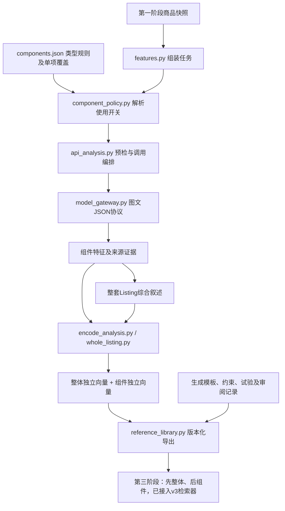

# 第二阶段项目架构

更新：2026-11-02，按清理后的实际文件组织。沿用原七阶段，不改第一阶段采集和第三阶段匹配的业务边界。

## 数据流



## 实际目录

```text
ListingStage2/
├─ README.md
├─ run_api_analysis.ps1       新API分析入口，默认预检
├─ run_stage2.ps1             原五商品实验入口
├─ project-manifest.json      文件哈希与实施状态
├─ cleanup-report.json        回收站清理记录
├─ config/                    API、组件开关、生成方案和实验配置
├─ src/listing_stage2/         实际运行模块，职责见 file-map.md
├─ tests/                     34项测试
├─ data/
│  ├─ analysis_tasks/          待分析任务
│  ├─ source_links/            原有来源关联
│  ├─ rank1_experiment/        视频关键帧与人工分析证据
│  └─ listing_embedding_cache/ 保留编码缓存，避免重复计算
├─ outputs/
│  ├─ api_analysis/            预检、分析和编码输出
│  ├─ reference_library/       双层特征库与配置验证示例
│  ├─ experiments/            第一名v3结果
│  ├─ batches/                保留当前五商品v2批次
│  └─ listing_demo/           所有已生成图片、对比与文案实验
└─ docs/                      当前架构、契约、API说明及业务设计
```

## 核心对象

| 对象 | 内容 |
| --- | --- |
| 整套Listing | 身份、来源快照、整体关键词/卖点/客群/风格/信息顺序、整体独立向量 |
| 组件 | 主图、附图、标题、每条五点、详情、A+和视频各自的特征、向量、原始证据 |
| 生成方案 | 构图、提示词模板、变量、约束、适用范围、验收条件和验证记录 |
| 检索投影 | 整体索引和组件索引分别保存，以Listing版本和组件ID关联 |

整体叙述独立编码，不用组件向量平均值代替。原始媒体引用第一阶段文件/对象存储。模型来源声明不能充当自有产品事实。

## 组件配置

支持 enabled、include_in_overall、embed、retrieve、generation_reference；类型可设 max_components。优先级为源分析开关/内置默认 → defaults → roles → listings[版本][part_id]，最后执行总开关、数量上限和依赖约束。实际角色包括 main_image、gallery、aplus、title、bullet、video。

- enabled=false：保留原始来源，但停止使用。
- embed=false：关闭活动组件向量，自动关闭检索。若仍参与整体或生成参考，分析仍可能需要API调用。
- retrieve=false：关闭组件检索，不改变原整体向量。
- generation_reference=false：暂停引用它的生成方案。
- max_components：按原组件顺序限制数量，不是按质量评分筛选。

改变已有v3整体参与集合时，标记 requires_review_and_reencode，整体及组件索引暂停导出。需要新审阅、新编码版本，不能继续使用旧整体向量。新API入口可在调用前筛选，完成分析后将有效开关继承到结果。

## 版本与生成方案

listing_version_id 对应v3 bundle_id；projection_version_id 区分不同配置下的检索视图，历史记录保留。磁盘目录用短哈希避免Windows路径过长，JSON保留完整ID。向量按模型摘要、配方和维度隔离，查询不能跨空间比较。

模板状态 draft/experimental/validated/retired。validated 要求声明范围内至少三次同条件试验、全部验收项通过、有绑定版本的审阅记录；程序只检查记录结构，不能证明记录真实或泛化稳定。竞品参考只定义表达，不定义自有产品外观、参数或认证。

## 当前边界

API层支持Chat Completions兼容图文JSON与本地Ollama编码，已做无联网预检和模拟测试，未完成真实供应商联调。新入口不发送原始视频、不自动转录、不生成图片、不自动评分或批准、不写MySQL或Qdrant。

原有聚类和历史MySQL试验保留。FiftyOne、Qdrant、Langfuse、LangGraph集成，以及视频预处理、正式审核模块仍待开发；已移除没有代码的占位文件，需要实现时再新增。

使用方法见 [API接入配置.md](API接入配置.md)，字段见 [data-contract.md](data-contract.md)，存储边界见 [storage-design.md](storage-design.md)。
