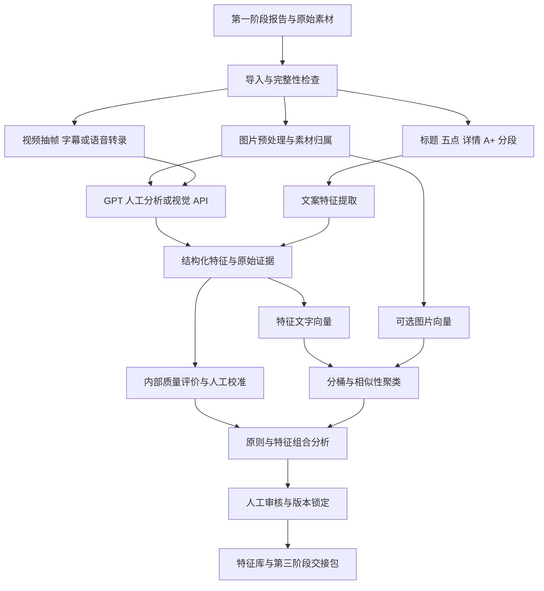

> 2026-11-02 更新：已新增整套 Listing 向量、同第一阶段的分类目录、整套检索与组合选择 CLI，以及 MySQL 整体包读回验证。当前行为和新增文件以 [最新实现说明](整体Listing实现.md) 为准；下文保留早期状态与后续规划。

# 第二阶段完整方案：分析、聚类优秀元素

文档日期：2026-10-30。范围沿用原七阶段中的第二阶段，不重新划分业务流程。

本文同时描述完整目标与当前试验。标注“规划”的内容尚不能作为现有接口或上线功能使用。代码逐文件状态见 [文件说明](file-map.md)，操作方法见 [运行手册](runbook.md)。

## 1. 第二阶段要解决什么

把第一阶段采集的图片、标题、五点、普通详情、A+及可用视频，转换成可追溯、可比较、可检索的结构化特征库。回答：素材用了什么表达方式、相似表达有哪些、适合什么市场和场景、有哪些可借鉴原则，以及什么情况下不适用。

输入除了原始素材和快照，还包括内部设计规范、运营规范、标签体系、优秀素材评价标准及人工校准样本。输出交给第三阶段，第三阶段再根据自有产品事实及卖点匹配参考。第二阶段不生成自有 Listing，不发布亚马逊商品，也不把竞品声明当作自有产品事实。

BSR、搜索位置、内部质量分是不同指标。搜索排序或本次采集顺序不能改名为 BSR；只有带类目、观察时间和证据的真实排名才能保留相应排名类型。没有可靠排名的素材保留“精选参考”标记，不能推测排名。

## 2. 当前实际交付与差距

| 能力 | 当前状态 | 完整目标 |
| --- | --- | --- |
| 第一阶段输入 | 校验并读取旧试验冻结的前五商品 payload | 直接读取任意受支持的第一阶段报告，按批次、ASIN、快照选择 |
| 图片理解 | 复用此前 GPT 逐图审阅记录 | 人工 GPT 导入与后续视觉 API 共用契约 |
| 文案分析 | 复用已整理的标题、五点等特征 | 通用分段、提取、证据定位和增量重分析 |
| 图片向量 | 尚未实现像素编码 | 可选多模态模型直接编码图片 |
| 文本向量 | 107 条 Nomic 文本向量，768 维 | 固定编码配方、版本隔离、按变更重算 |
| 聚类 | 65 条图片特征按文字向量分成 16 组 | 人工校准、异常样本处理、稳定版本及解释 |
| 质量评价 | 总分 null，状态 uncalibrated | 按获批标准评分，并保留理由、证据和人工校准 |
| 可借鉴原则 | 5 条商品级候选分析 | 经审核的原则、限制条件及跨样本证据 |
| 视频 | 当前无输入，跳过 | 抽帧、字幕/转录、时间定位、片段特征 |
| 存储 | 本地 JSON、HTML及试验 MySQL | 独立存储层、迁移、审核和版本记录 |
| 人工界面 | 只读本地图片浏览页 | 编辑、退回、批准、版本锁定 |
| 第三阶段交接 | pending_review 文件索引 | 仅将明确可用的版本交给正式匹配流程 |

现有结果：5 个商品、65 张图片、107 条特征及文本向量、16 个候选分组。特征包括图片 65、标题 5、五点 26、普通详情 1、A+ 文本 5、商品汇总 5。五点数量以来源为准，不强行截成五条。缺失普通详情保留缺失，不用 A+ 或模型补文冒充。

现有结果中的质量分不是零分，而是尚未评分；候选分组不代表优秀；候选原则不代表已验证的高分组合。历史运行记录显示付费 API 调用为 0，本轮补文档没有执行模型调用或数据库写入。

## 3. 数据流及每一步新增什么

下图为完整目标；当前入口直接从已生成的前五商品 payload 开始，尚未实现图中全部节点。

| 过程 | 新增输入 | 加工 | 输出 |
| --- | --- | --- | --- |
| 导入 | 来源契约、选择范围 | 校验文件、哈希、引用与缺失项 | 导入清单、排除原因、快照关联 |
| 预处理 | 尺寸/格式规则、抽帧策略 | 解码、生成分析副本、分段、定位 | 图片任务、文本块、视频片段 |
| 识别 | 标签体系、提示词、分析规范 | 观察、分类、提取表达手法 | 特征 JSON、证据、未知项 |
| 向量化 | 编码模型、输入配方 | 清洗、编码、归一化、校验 | 向量及模型/配方版本 |
| 聚类 | 分桶字段、相似阈值 | 按可比范围分组 | 成员、代表素材、相似度 |
| 评分 | 内部标准、锚点样本 | 分维度评价和校准 | 得分、理由、适用性、待复核项 |
| 原则提炼 | 分组及有效评分 | 比较组合、找反例与适用边界 | 候选原则、样本数、证据 |
| 审核导出 | 人工确认 | 锁定具体版本 | 可用特征库、交接清单 |

## 4. 导入、去重和归属（规划）

以第一阶段 `report.json` 作为结构化入口，读取已成功保存的媒体记录；不要将页面里发现但未成功下载的所有图片 URL 当成现有图片。读取 `media.status=stored` 的文件并核验哈希、路径、类型、尺寸及解码结果。原始素材只读。

建议导入范围支持 report 路径、市场、ASIN 列表及数量上限。一次任务固定来源报告哈希、商品 snapshot_id 和配置版本，避免运行中混入后来采集的数据。run_id 是采集批次，不能代替商品 snapshot_id。

同一文件内容通过 SHA256 只存一份资产，但每次在某个商品、快照、A+ 模块中的出现都保留独立 reference。相似图片只做近重复标记，不自动删除，因为不同裁剪和文字版本可能有分析价值。

主图角色继承第一阶段的主图证据；不确定时标记待复核，不能仅以文件名或第一张图片推断。A+ 中可能出现其他产品、品牌标志、对照表，需保存 identity_scope：当前商品、产品系列、关联产品、品牌素材、未知。归属不明或不属于当前商品的内容不能默认成为其参数证据。

## 5. 图片、文本和视频预处理（规划）

图片保留原图；分析副本记录父资产哈希、缩放或裁剪规则。按图库、普通详情、A+ 模块组织任务，长图可切片但必须保留切片位置。OCR 仅辅助识别图中文字，保存来源为 OCR 及不确定性，不覆盖网页原文。

文本按标题、每条五点、普通详情段落、A+ 模块分别建块。保存原语言原文、序号、模块位置、source_url 和快照。分析用翻译单独存，不替换原文。对重复导航、店铺推荐、其他产品描述作显式标注。

视频按原视频哈希建立资产，保存时长、格式与来源。按场景变化及采样上限抽关键帧；字幕和音频转录分别记录来源和时间戳；帧与转录片段关联。最终形成“片段特征”，不能把一帧观察扩展为整段视频事实。当前第一阶段该批次没有下载视频，第二阶段应输出 skipped_no_input，不能当成失败或声称分析完成。

## 6. 由 GPT 暂时代为分析，后续换 API

人工交互和 API 应产出同一种结构化记录。当前已经有前五商品的历史 GPT 记录，默认运行只是读取它们，不会在后台调用当前聊天模型重新看图。

后续人工批次按以下步骤执行，相关自动组包和导入工具待开发：

1. 建立任务清单：ASIN、快照、图片 reference_id、文件哈希、原文位置及任务版本。
2. 提供原图或可读联系表及文本。小字、长图和认证图需打开原图核对；无法辨认写 unknown。
3. GPT 为每张图片、每段文案分别输出结构化特征，不能仅给商品级泛泛总结。
4. 导入时校验任务 ID、资产哈希、必要字段、枚举、证据引用及重复记录。
5. 运营确认归属、误识别、适用性与标签，记录修改理由。审核批准绑定记录版本。
6. 被修改的特征重新编码，并使依赖的分组、评分和原则进入待更新状态。

分析至少区分：直接可见观察、页面或图片宣称、分析推断。例如“蓝色背景”是观察，“图中标注 cooling”是竞品宣称，“适合突出清凉感”是分析建议；三者都不能证明产品确实有降温功效。

保存 producer_type、分析时间、提示词版本、来源和审阅者；无法确认具体模型版本时记录 unknown，不猜测模型 ID。人工 GPT 协议详见 [人工分析规范](manual-analysis-protocol.md)。

## 7. 结构化特征体系（规划）

| 对象 | 推荐特征 | 证据位置 |
| --- | --- | --- |
| 图片 | 用途、主体布局、背景、色调、留白、场景、人物、风格、文字密度、卖点表达、产品归属 | reference_id，必要时区域坐标 |
| 标题 | 品牌位置、品类词、核心卖点顺序、规格表达、语言风格 | 原标题及字符区间 |
| 五点 | 每条主题、利益/参数顺序、句式、场景和客群表达 | 条目序号及原文 |
| 详情/A+ | 模块结构、信息顺序、图文关系、比较方式、叙事节奏 | 模块编号、文本块、图片引用 |
| 视频 | 场景、镜头用途、卖点演示、字幕风格、节奏 | 起止秒数、关键帧及字幕片段 |
| 商品汇总 | 产品结构、表达路线、重复卖点、缺失信息、可借鉴原则及限制 | 关联各素材特征版本 |

客群、场景、风格既可能直接出现，也可能是推断，应带 evidence_basis。产品参数和认证只记录“来源宣称及验证状态”，不能通过视觉推断认证真实性。标签有 taxonomy_version；新增标签先进入候选，不随意改旧记录语义。

## 8. 向量化：两条通道

当前通道是“图片 → 人工 GPT 文字特征 → Nomic 文本向量”。它编码的是观察描述，适合按卖点、场景和表达含义查找；无法保证保留文字没有描述的纹理、几何或构图细节。

当前模型为本机 Ollama 的 `nomic-embed-text:latest`，768 维、单位归一化；配方 `nomic-search-prefix-2400-v1`。latest 只是名称，复现还需保存实际 model_digest。当前 `embeddings.py` 的标记函数尚未接入主流程，不应假设导出 JSON 已带 vector_kind 字段；现有向量类型以文档和来源配方说明。

可选新通道为“图片像素 → 图片/多模态向量模型”，用于视觉相似性。选择模型前用真实样本验证跨语言、细节和图文检索效果；不同模型、维度、配方的向量分空间保存，不能直接求余弦。图文联合检索需要模型本身的对齐空间，不能仅因维度相同就混用。

规划保存 embedding_id、feature_version、模型名、digest、维度、input_sha256、预处理配方、向量类型和生成时间。输入改变只重算相关向量；长文本按语义分块，保留块到原文的位置，不静默截掉关键内容。多个通道可在第三阶段按校准后的分数融合，不直接拼接任意向量。

## 9. 聚类及结果解释

现有算法：先按 source_role、product_form、identity_scope 分桶，再按 entity_key 排序；将样本与各组固定的首个代表比较余弦相似度，达到阈值则加入最相近组，否则新建组。默认阈值 0.78，只处理图片特征文字向量。代表不会更新成质心。当前 16 组是这个固定样本和阈值下的结果。

该算法易理解、可复现，但阈值尚未业务校准，不具备最优聚类保证。C001 等编号仅在该运行版本内解释；输入变化后不能把同名组当成同一业务分组。相似度不是质量分，也不是第三阶段的产品匹配分。

后续根据标注的“应同组/不应同组”样本校准，统计组内一致性、错分和孤立样本。需要时再评估其他算法。组结果保留算法版本、空间、阈值、代表素材、成员、相似度、共有特征和差异说明；解释只能引用实际成员证据。聚类不使用 BSR 提高素材相似度。

## 10. 质量评分与优秀组合（规划，尚未实现）

先明确评价对象：单图、单段文案、A+ 模块或整套 Listing，使用不同评分表，不能用同一表机械比较主图和场景图。

建议先讨论以下维度：信息清晰度、卖点表达、视觉层级、场景适配、语言自然度、品牌一致性、可借鉴程度。每项设置 1–5 分及具体锚点，并记录理由和证据。维度、权重和通过阈值需运营校准后启用；本文不是已批准的评分配置。

可见性不足、来源缺失、产品归属不清时先标记不可评价或待复核。认证真伪和功效真实性不能仅靠图片模型判定。第二阶段评价参考素材质量，不代替第五阶段对最终自有商品内容的真实性与平台约束检查。

高分组合分析在有效评分积累后进行：统计特征共同出现的次数、不同商品覆盖数、评分分布及反例，并按市场、品类、用途分层。避免同一 ASIN 多张近重复图片被当作多个独立商品样本。只有五个商品时，可提出候选原则，不作稳定规律结论。高内部评分和 BSR 的相关性均不能证明某种设计带来销量提升。

## 11. 存储和数据边界

原图、原视频、HTML 等文件继续由第一阶段管理；第二阶段保存引用和校验值。当前通过本地路径访问，以后可换对象存储 key。向量和特征不应以大段文本塞进图片文件名。

现有 MySQL 为 `127.0.0.1:3307/listing_analysis_pilot`，复用六张试验表，并新增 stage2_exports。凭据保留本地配置，不写文档。现有向量存 JSON，Python 计算余弦，尚无数据库向量索引；Qdrant 并未接入。

正式版建议用 MySQL 管理任务、素材引用、特征版本、评分、原则和审核关系；对象存储放媒体与分析副本；数据量与检索性能确有需求时再将向量同步到 Qdrant。向量索引可重建，业务版本和审核记录以关系库为准。详细表规划见 [存储设计](storage-design.md)。

## 12. 运行、失败恢复和费用

当前使用顺序 Python CLI，依赖 D:/ListingAnalysis，不能单独复制本目录就部署。默认复用已有向量，不调用付费 API；RefreshVectors 会通过旧试验代码访问本地 Ollama。当前未实现完整任务调度、检查点、并发锁、API 预算和自动重试策略。

现有导出先写文件，再可选写数据库，最后更新 latest.json。文件、核心六表与 stage2_exports 不是跨系统原子事务；中途失败可能留下部分结果。每个 JSON 文件使用临时文件替换并不等于全批次事务。发生异常应检查具体输出与日志，不把某个 JSON 存在当作整批成功。

规划给任务建立 pending/running/waiting_review/succeeded/partial_failed/failed 状态；按任务项记录错误和重试次数。哈希变化、字段错误应修正输入后重跑；临时网络错误可限次退避重试；预算不足停止新调用。API 模式需在运行前显示模型、样本数、图片/帧数及费用上限，实际调用后记录用量。输出状态与审核状态分开保存。

## 13. 向第三阶段交付什么

当前 stage3_bundle.json 是相对路径索引，指向 payload、clusters、quality、principles，状态为 pending_review；不代表所有候选均已批准。当前没有完整的审核拦截程序。

正式交接包应含：schema_version、分析批次及版本、素材和快照引用、特征及证据、向量空间信息、分组版本、质量分或未评分状态、适用市场/品类/场景、限制条件、审核状态和原始排名观察。与第三阶段约定哪些待审内容只能预览，哪些批准版本允许参与推荐。

第三阶段按自有产品事实筛选和匹配；参考素材上的参数、认证、功效不得被复制成自有商品事实。第二阶段的相似分组不等于第三阶段的匹配排序。

## 14. 开发顺序与验收

1. **固化现有试验**：保留五商品样本与哈希，补文档和基线。已有试验可运行，但不是完整上线验收。
2. **独立导入与人工分析闭环**：实现任意第一阶段报告读取、分析任务清单、人工 JSON 导入及校验。验收新增 ASIN 无需改业务代码即可完成证据关联。
3. **特征/向量与增量版本**：独立编码适配器、文本块契约、变更失效关系。验收改一张图只重算依赖项，不复用旧向量。
4. **聚类与质量校准**：建立人工锚点，验证阈值，落实评分及原因定位。验收相似度和质量分独立、未知项可追踪、错误归属被隔离。
5. **审核与第三阶段交接**：实现修订、批准、版本锁定及交接验证。验收修改后旧批准不自动继承，交接可还原原图原文。
6. **按需扩展**：视频、像素向量、视觉 API、FiftyOne、Qdrant、Langfuse 和任务编排。每项独立验证收益，不要求同时部署。

测试覆盖应逐步加入：空批次、缺图、重复媒体多处引用、A+ 关联产品、非英语文本、超长文本、错误 JSON、混合向量空间、数据库部分失败及审核失效。现有仅四项单元测试，详见运行手册。性能、费用、聚类准确率与人工一致性的上线阈值尚未批准，不能宣称已达标。

## 15. 多来源与素材关联补充（2026-11-02）

第一阶段已增加 config/sources.json 多来源注册、按来源选择及 --plan 校验入口，并放开美国 BSR 的固定 Topper 类目。每个来源独立配置国家、语言、类目、说明和采集上限；其他市场仍需适配，不能仅改字段即运行。详见 D:/Crawl4AI/docs/多来源与素材关联.md。

新导出的商品目录将生成 素材关联.json，按 source_id、marketplace、ASIN、snapshot_id、run_id 将图片/视频记录、标题、逐条五点及详情对应；A+ 模块保留网页明确的图文关系。五点和图片的卖点语义为多对多关系，待第二阶段分析，不能按次序猜测。

已只读转换原采集批次，关联样例在 data/source_links/20261029T004510Z_fdcb2277_content_a81a90/index.json，原报告未修改。这是新增关联契约的样例，当前第二阶段固定五商品主流程尚未自动加载它。素材路径和视频状态以原记录为准，没有新增下载。
