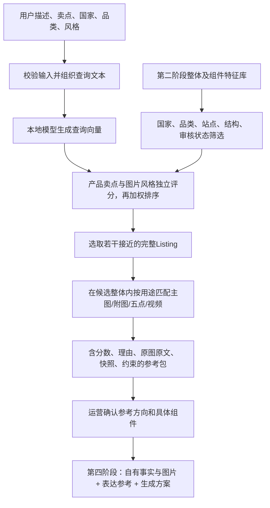

# 第三阶段项目架构与交接

## 数据流

## 实际行为

整体检索使用整体叙述向量，组件检索使用独立组件向量。当前都是语义文本向量，不是直接像素向量或原视频向量。查询沿用第二阶段同一Nomic模型摘要与search_query前缀，拒绝不同模型或配方混用。

国家和品类为硬条件，站点和产品结构可选。产品卖点查询与风格查询分别编码；前者对照整体向量，后者对照合格图片描述向量并取最高若干张均值。默认65%产品卖点、35%视觉风格排序。整体similarity为综合分；两路原始余弦分单独保存，不包装成百分比或质量评分。详见[整体双路评分](整体双路评分.md)。

组件必须属于已选整体、在活动组件索引内、开关允许检索及生成参考。关联商品图片不作为当前产品参考；未知身份图片默认排除。旧视频缺少identity_scope时，只接受来源快照ID与文件哈希明确绑定的组件，并保留采样分析范围，不能把关键帧分析说成完整视频理解。

同国家不同网站可检索，但当前实际数据仍主要为Amazon。暂不自动调整语义/质量权重；阈值需固定样本校准。没有合适整体或某类组件时显式返回空结果，交运营调整条件或扩大库。

## 输出

reference_package.json 包含 input_request、query、whole_candidates、reference_needs、missing_generation_inputs，以及draft状态。每个组件保留listing_version_id、part_id、来源身份、原文、特征、媒体路径、快照证据、模块位置和相关生成方案。

index.html用于本机预览，引用本地媒体而不复制原件。library_inventory.json记录读取哪些库。当前不自动批准、锁定版本或生成图片；available_recipes可能只是draft，仍需运营审核和真实产品事实。

## 第一阶段补采与本阶段的关系

第一阶段新增媒体先保存在原件库和新补采报告；第二阶段需要重新提取特征/编码并导出新库版本，第三阶段才可检索。此更新不自动重写旧审阅或旧整体向量。完整原始素材和向量化组件数量可以不同。

## 验证

tests/test_matching.py覆盖整体优先、硬过滤、禁用开关、缺失资料、无匹配、模型不兼容、关联商品隔离、输入类型、索引路径边界与重复投影规则。首次真实匹配使用本地Ollama，没有付费API调用。
